# TDrive PR #201 — Editable folder path bar

Feature-specific screenshots for [PR #201](https://github.com/jeetrex17/TDrive/pull/201), not general CI regression captures.

The sequence shows the path edit affordance, editable field, not-found feedback, local-path warning, and file-selected state in dark and light themes.

Displayed at 280 px wide, three previews per row.

<table><tr>
<td align="center">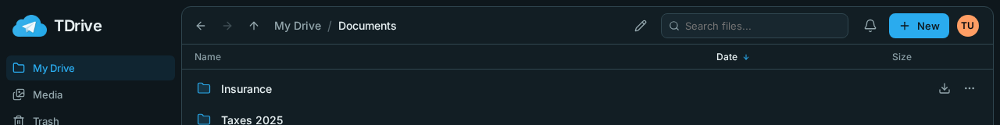 dark-1-hover-edit-button-header.png</td>
<td align="center">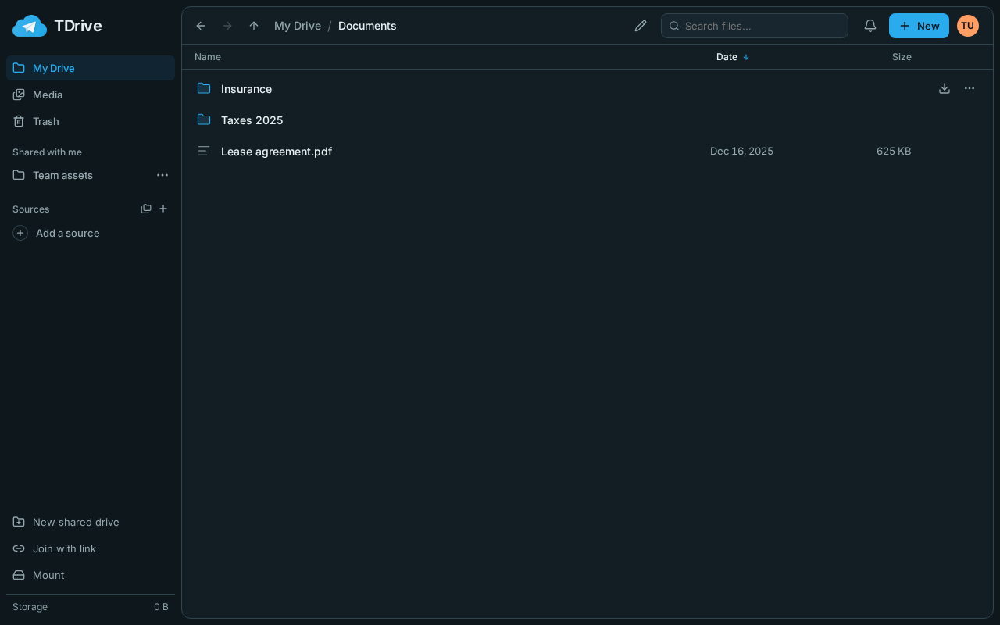 dark-1-hover-edit-button.png</td>
<td align="center">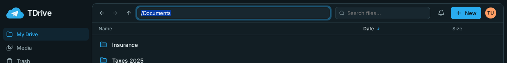 dark-2-field-open-header.png</td>
</tr></table>

<table><tr>
<td align="center">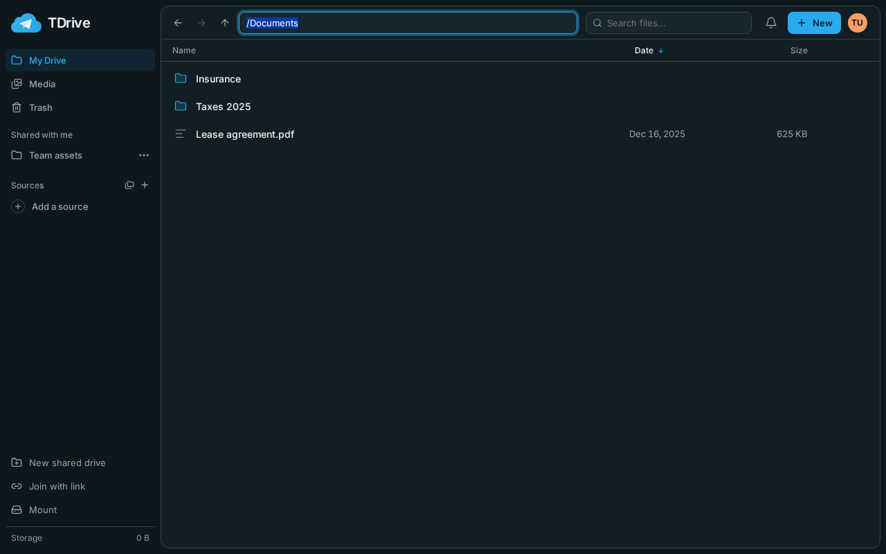 dark-2-field-open.png</td>
<td align="center">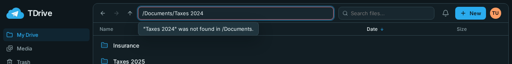 dark-3-not-found-header.png</td>
<td align="center">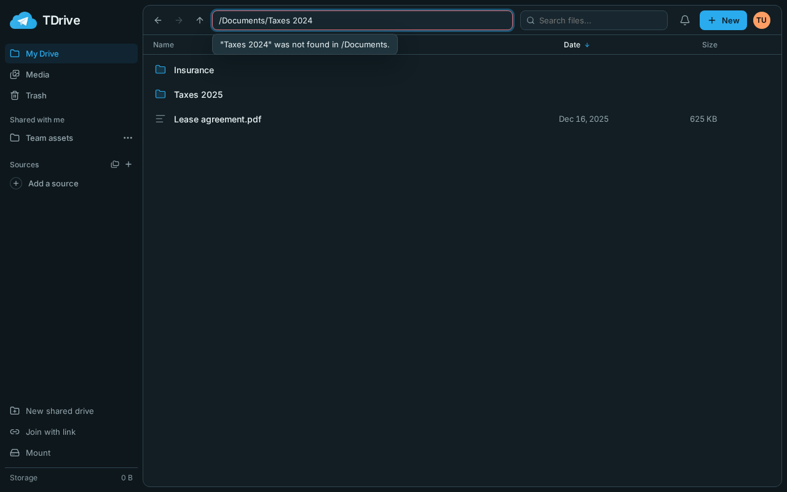 dark-3-not-found.png</td>
</tr></table>

<table><tr>
<td align="center">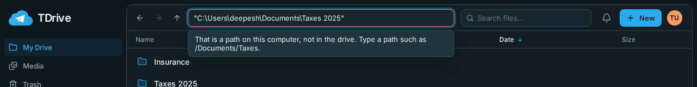 dark-4-local-path-header.png</td>
<td align="center">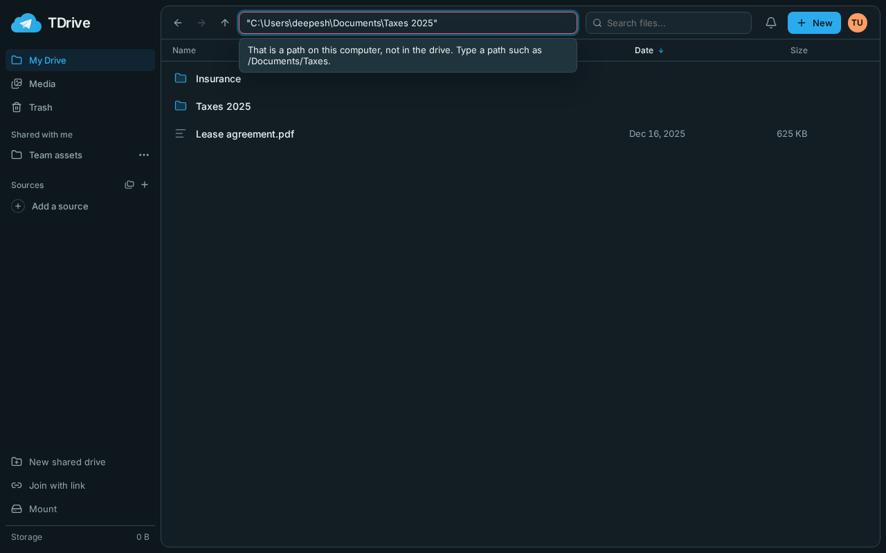 dark-4-local-path.png</td>
<td align="center">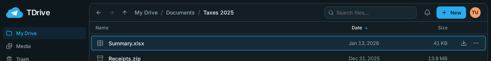 dark-5-file-selected-header.png</td>
</tr></table>

<table><tr>
<td align="center">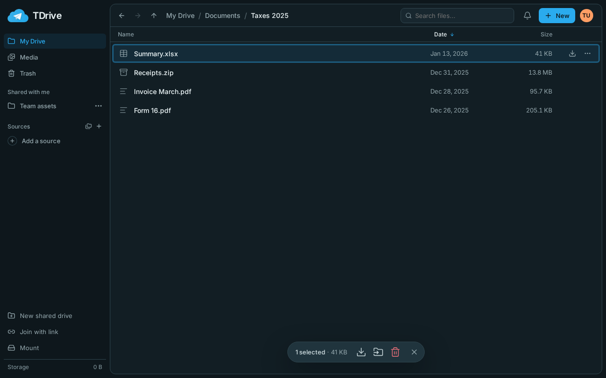 dark-5-file-selected.png</td>
<td align="center">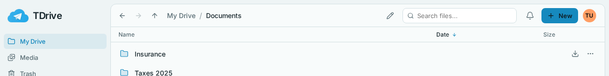 light-1-hover-edit-button-header.png</td>
<td align="center">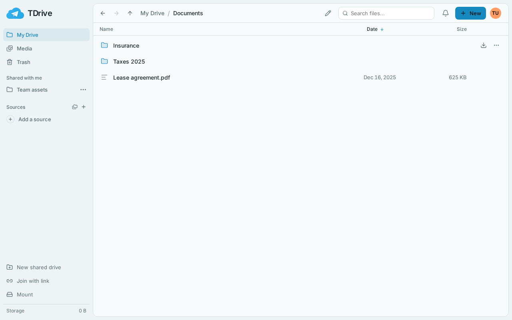 light-1-hover-edit-button.png</td>
</tr></table>

<table><tr>
<td align="center">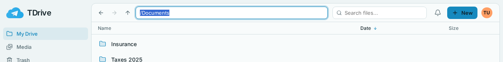 light-2-field-open-header.png</td>
<td align="center">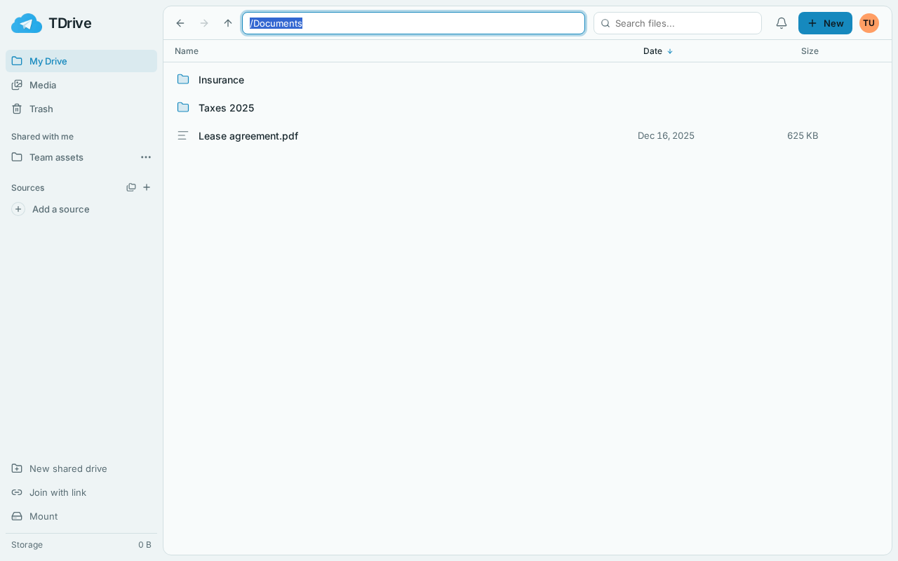 light-2-field-open.png</td>
<td align="center">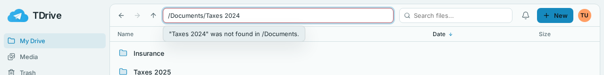 light-3-not-found-header.png</td>
</tr></table>

<table><tr>
<td align="center">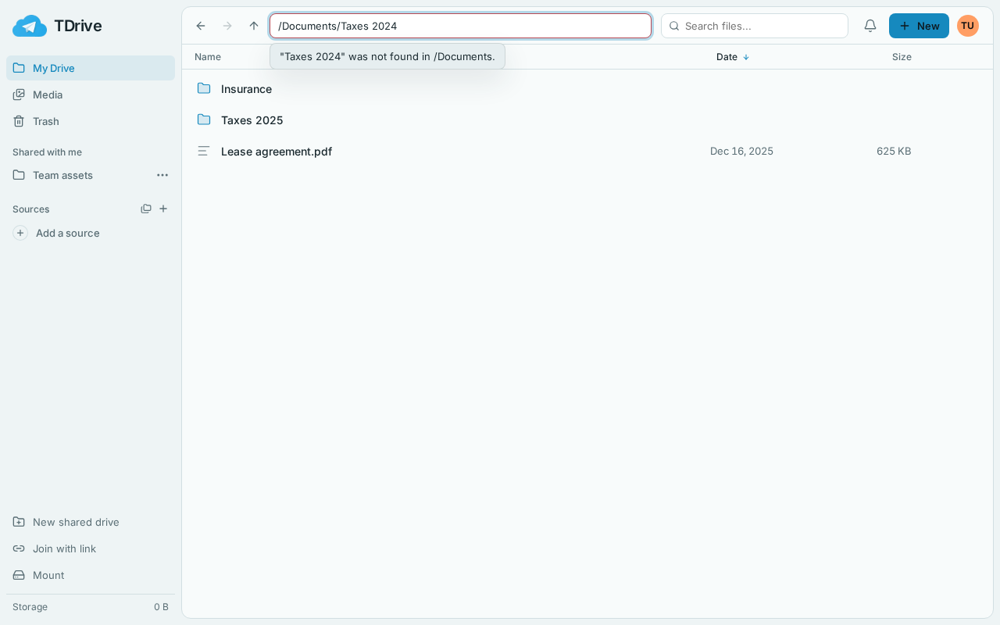 light-3-not-found.png</td>
<td align="center">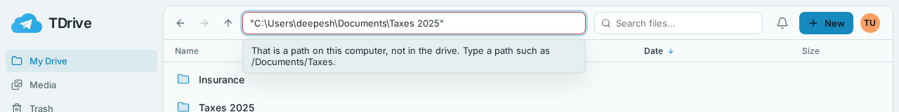 light-4-local-path-header.png</td>
<td align="center">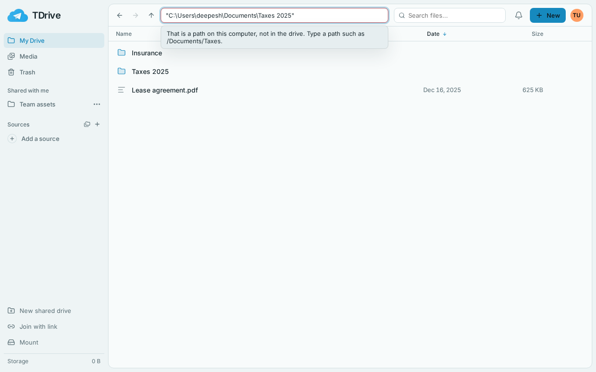 light-4-local-path.png</td>
</tr></table>

<table><tr>
<td align="center">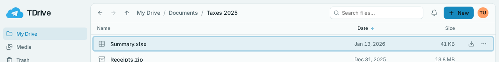 light-5-file-selected-header.png</td>
<td align="center">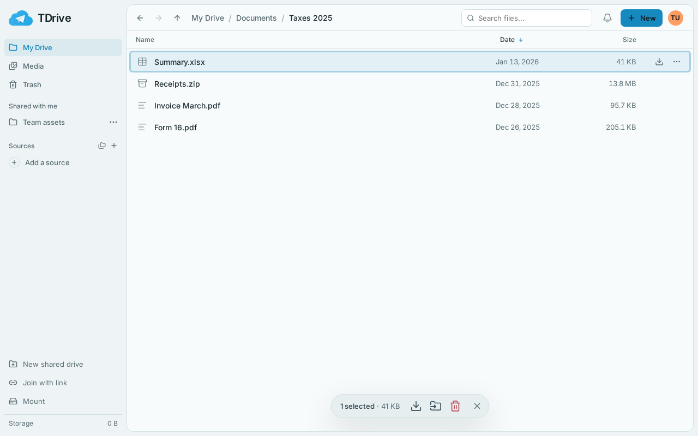 light-5-file-selected.png</td>
</tr></table>
