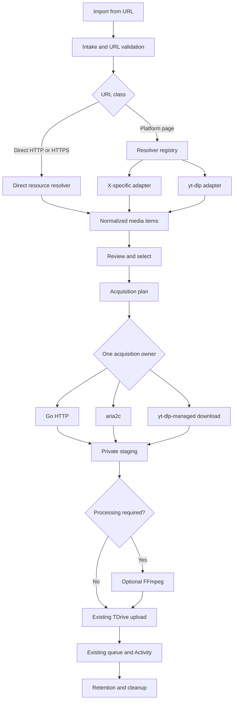
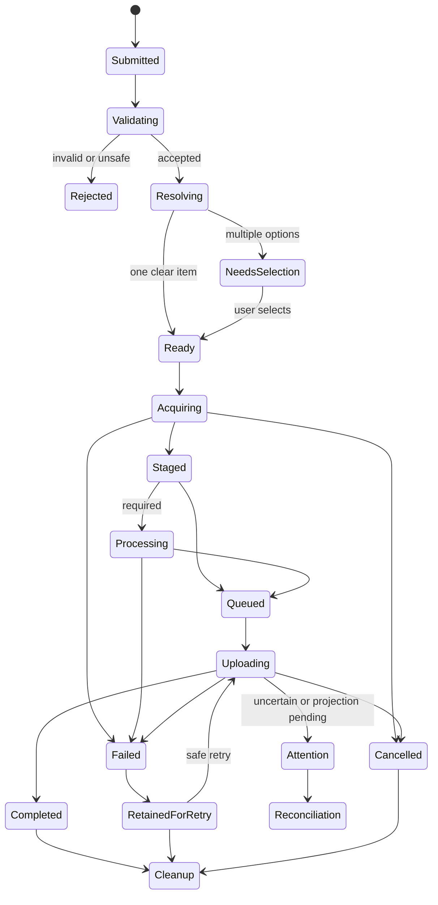

# Architecture: URL Resolution, Acquisition and TDrive Upload

## Goals

Support direct/platform URLs plus browser drag-and-drop and clipboard File/Blob inputs; unify intake, separate resolution, acquisition/staging and upload; normalize provider metadata; permit several download engines; stage privately where seekable files are needed; preserve TDrive queue/upload behavior; make progress, cancellation, retry and cleanup observable; enforce one SSRF policy across network paths.

## Unified intake architecture

All inputs enter source-specific intake adapters and produce a common normalized import item. URL inputs proceed through resolution and remote acquisition. Browser File/Blob inputs proceed through bounded local staging. URL-only drag/clipboard payloads are revalidated and use the URL path. Both paths converge on review, the existing queue and upload adapter.

## High-level architecture



The diagram is a set of alternative paths. A single item must have exactly one downloader owner. FFmpeg only runs if the selected output requires it.

## Components

### Intake adapters
- Accept URLs, browser-dropped files/images, URL-only drags, and user-initiated clipboard image/file paste.
- Normalize every accepted input to a stable item ID and explicit source kind.
- Inspect DataTransfer.files/items and clipboardData.items/files; payloads may contain bytes, URL text, or both.
- Handle paste only on the import surface; never poll clipboard in the background.
- Route URL-only payloads through backend URL validation; never fetch them directly from renderer code.
- Stream/chunk File/Blob data to private backend staging with bounded memory; avoid whole-file base64.

### URL intake and validation
- Accept one or more user URLs.
- Parse and normalize safe syntax only; client validation is not a security boundary.
- Allow HTTP/HTTPS only initially.
- Assign stable request/item IDs.
- Apply input length, batch size and duplicate-input policy.
- Return structured validation errors before acquisition.

### Resolver registry
Each resolver identifies supported URL patterns and implements a bounded, cancellable metadata-resolution operation with no upload side effects.

Adapters:
- Direct HTTP(S) resource resolver.
- X-specific post/media resolver.
- yt-dlp-backed generic platform resolver.
- Future provider-specific resolvers.

Fallback must be bounded, observable and configurable.

### Normalized media model

Conceptual schema (adapt to Go conventions and current frontend serialization):

```go
type ResolvedMedia struct {
    RequestID       string
    Resolver        string
    Platform        string
    PageURL         string
    Title           string
    SuggestedName   string
    MediaType       string
    MIMEType        string
    SizeBytes       *int64
    DurationMillis  *int64
    Width           *int
    Height          *int
    ThumbnailURL    string
    Variants        []MediaVariant
    SelectedVariant string
    DirectURL       string
    Headers         map[string]string
    URLExpiresAt    *time.Time
    Warnings        []string
}

type MediaVariant struct {
    ID            string
    FormatID      string
    Container     string
    VideoCodec    string
    AudioCodec    string
    Width         *int
    Height        *int
    Bitrate       *int64
    Filesize      *int64
    Protocol      string
    RequiresMerge bool
}
```

This is illustrative, not a mandated API. Keep unknown values nullable. Avoid storing signed URLs or auth headers in persistent Activity state. Metadata shown to the user should not imply a value is known when the resolver did not return it.

### X resolver

Three approaches surfaced in the discussion:

1. **Official X API v2** when developer access and the current endpoint schema support required fields. The sample request used `attachments.media_keys` and `media.fields=variants,...`, but do not assume `variants` is accepted/available on every endpoint or plan. Verify current official docs and an actual authorized response before relying on it.
2. **Public syndication endpoint**, e.g. `https://cdn.syndication.twimg.com/tweet-result?id={TWEET_ID}&lang=en`. This is undocumented/unofficial, can change or be rate-limited, and must be isolated as optional best-effort behavior.
3. **yt-dlp X extractor** as a general-purpose supported fallback; test real representative posts against current yt-dlp versions.

Grok described an internal X post-fetch capability returning a structured post object and direct `video.twimg.com` variants. TDrive cannot call that internal capability. The useful architectural lesson is to resolve a post into media metadata first, then acquire the selected CDN resource. Do not use private GraphQL reverse engineering or brittle HTML scraping as the production foundation.

### yt-dlp adapter

Potential operations:
- Metadata/format discovery without download.
- Extract direct URL(s) when TDrive can safely acquire them.
- yt-dlp-managed download when extractor-specific headers, fragment logic, or format merging is required.

Use safe process invocation with argument arrays, controlled executable resolution, working directory, output template and environment. Support context cancellation and reap child processes. Decide how binary/runtime updates are handled. Current yt-dlp documentation notes FFmpeg/ffprobe are strongly recommended for merging/post-processing and that full YouTube support may require yt-dlp-ejs plus a supported JavaScript runtime. Validate exact requirements at implementation time.

### Acquisition manager

An acquisition descriptor must state who owns the download:
- `go-http`
- `aria2c`
- `yt-dlp`

Do not let yt-dlp and a separate aria2c/Go HTTP job download the same item independently. yt-dlp can itself delegate to aria2c; that is one owner (yt-dlp orchestration with aria2c external downloader), not two parallel downloads.

Backend contract:
- Run with cancellation context.
- Report byte progress and total where known, plus speed/ETA only when credible.
- Return staged path and actual file metadata.
- Classify network/source/policy/limit/disk/tool/cancel errors.
- Define partial-file cleanup or resumable state.
- Never leave unmanaged subprocesses.

### Go HTTP backend

Phase 1 default:
- Stream response to disk with bounded buffers.
- Context cancellation, response-header timeout and body idle timeout.
- Enforce byte cap even with absent or false Content-Length.
- Validate status and content disposition safely.
- Validate every redirect and destination.
- Use unique `.part` path and atomic finalization.
- Do not require a trusted checksum for arbitrary URLs; a local hash records acquired bytes but does not authenticate the origin.

### aria2c backend

Optional, likely Phase 4:
- Segmented/multi-connection downloading for eligible HTTP(S) sources.
- Resume partial HTTP(S) files only when supported and source identity is confirmed.
- Use ETag/Last-Modified or equivalent validators and verify range semantics.
- Configure conservative split/connection defaults; some CDNs reject or throttle parallel ranges.
- Govern aggregate concurrency and disk use from TDrive.
- Prefer stable machine-readable progress (e.g. controlled RPC) over parsing mutable human console output.
- Use unique private working directories and controlled output paths.
- Enforce the same SSRF/redirect/egress policy for every request aria2 makes.

### FFmpeg processor

Optional:
- Merge separate audio/video streams.
- Remux supported containers.
- Perform explicitly selected audio-only or other supported processing.

Prefer stream copy when possible. Avoid transcoding by default. Direct MP4 and ordinary files must not require FFmpeg.

### Browser file staging
- Stage browser File/Blob bytes into private app-managed storage through bounded streaming/chunked bridge calls.
- Enforce item-count, per-file, aggregate batch, disk and concurrency limits in the backend.
- Treat browser MIME and filenames as untrusted hints; sanitize names and validate actual bytes.
- Treat object URLs as ephemeral previews only; revoke them and never persist them as durable source references.
- Track cancellation, ownership and release through the upload lifecycle.

### Staging manager

- Application-managed private temp root.
- Per-transfer random directory with restrictive permissions.
- Unique partial and final paths.
- Disk/concurrency limits and optional headroom checks.
- Ownership tracking across acquisition → processing → queued upload → retry.
- Delete only after all readers/processes release the file.
- Cleanup on success/cancel/permanent failure under documented retention rules.
- Persistent recovery only if a journal is implemented; otherwise session-scoped staging.

### TDrive upload adapter

Feed staged paths into existing app upload APIs. Preserve:
- Active drive and expected channel checks.
- Destination parent ID.
- Encryption.
- Existing file limits and multipart/resumable handling.
- Upload events, queue and Activity.
- Per-file failure outcomes.
- Telegram send acceptance and local projection semantics.
- Source-release callbacks and upload semaphore.

Do not create a parallel Telegram uploader. Do not conflate acquisition retries with Telegram upload retries.

## State model



Expose separate resolution/acquisition/processing/upload states. "Download failed" must not be shown as "Upload failed".

## Browser API compatibility and bridge constraints

Verify DataTransfer and ClipboardEvent behavior in supported Wails/browser runtimes. Image drags may expose File bytes, URL text, or both. Clipboard access is user-gesture/event based and may be restricted. Large File/Blob data must cross the frontend/backend boundary through bounded streaming or chunks, not a single base64 payload. Ordinary paste outside the import surface must remain unchanged.

## Optional dependency strategy

| Tool | Role | Requirement |
|---|---|---|
| Go HTTP | Direct file acquisition | Built-in baseline |
| yt-dlp | Platform extraction and sometimes acquisition | Optional runtime/package decision |
| aria2c | High-throughput/resumable acquisition | Optional |
| FFmpeg/ffprobe | Merge/remux/process | Optional unless selected operation requires it |

A missing optional executable must not break simple direct URL imports.
